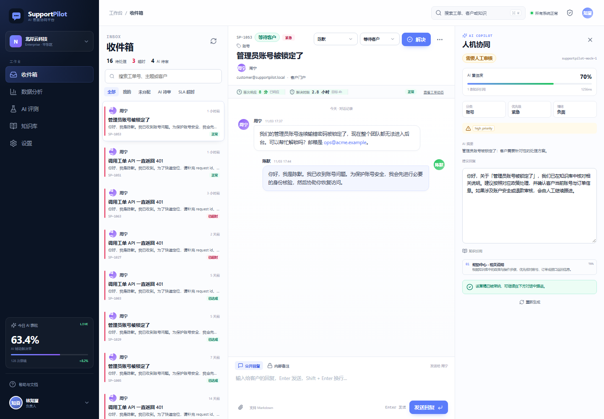
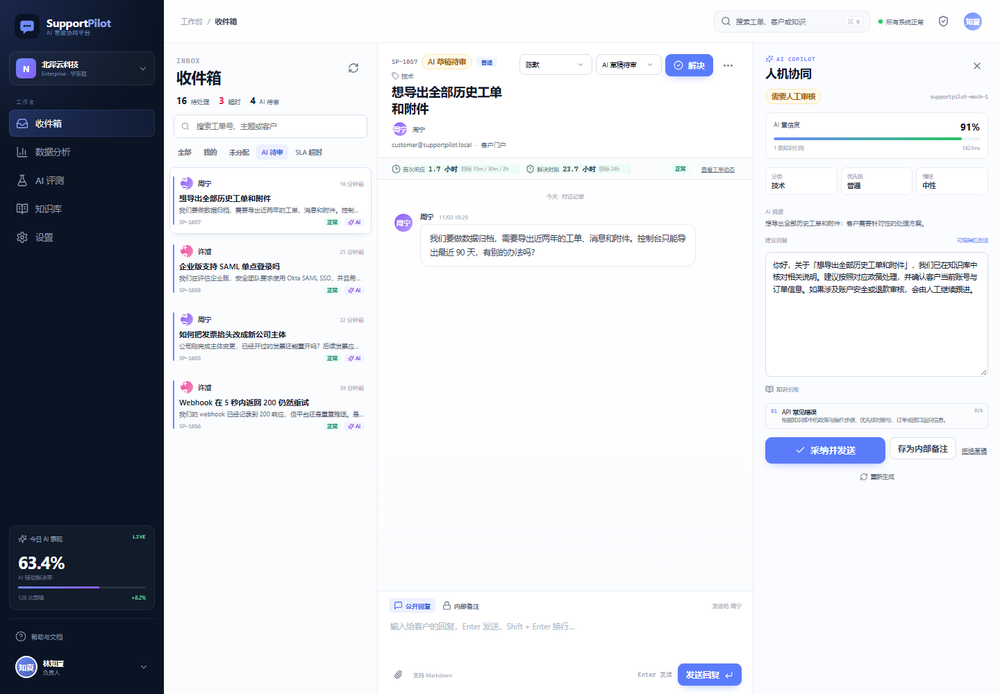
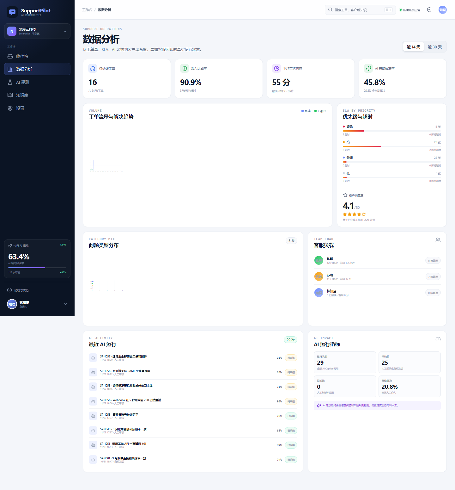
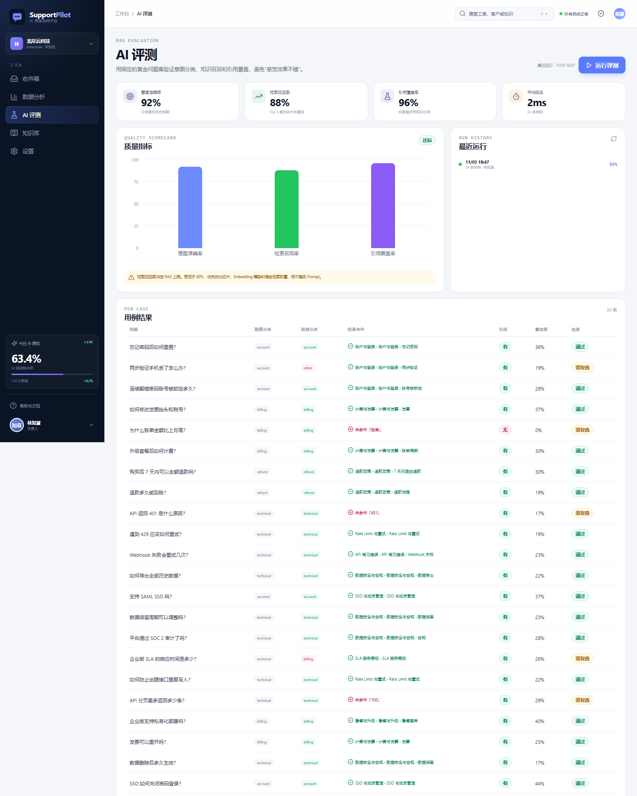
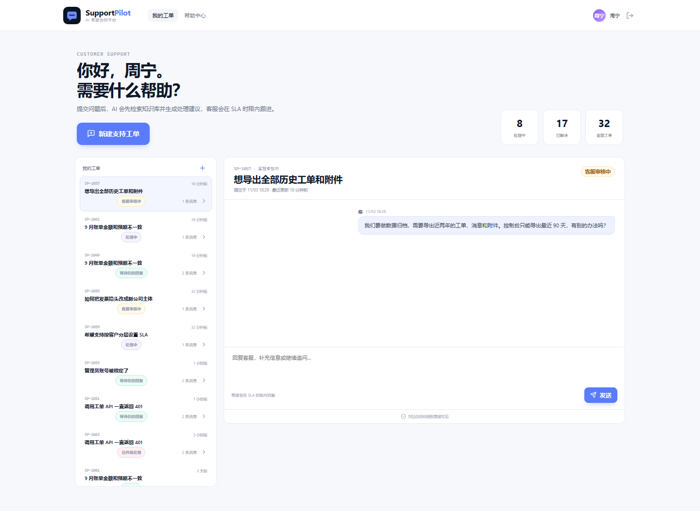
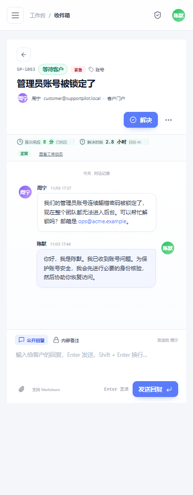

# SupportPilot · AI 客服协同平台

[](https://github.com/vitacool/supportpilot/actions/workflows/ci.yml)
[](https://vitacool.github.io/supportpilot/)
[](LICENSE)

**在线案例页：https://vitacool.github.io/supportpilot/**

**让 AI 处理重复问题，让客服专注复杂关系。**

SupportPilot 是一套面向企业客服团队的 AI 工单平台：AI 自动分诊、检索知识库、生成带引用的回复草稿；客服审核后发送；SLA、CSAT、AI 采纳率和 RAG 质量全部可观测。

它不是“聊天机器人 Demo”，而是一个完整的人机协同工作流：

```text
客户提交工单
  → AI 分诊（分类 / 优先级 / 情绪）
  → 混合检索知识库
  → 生成带引用回复草稿 + 置信度
  → 高风险 / 低置信度转人工审核
  → 客服编辑并发送
  → SLA / CSAT / AI 采纳率 / 评测回归
```



| 人机协同 Copilot | 数据分析 |
| --- | --- |
|  |  |

| AI 评测 | 客户门户 |
| --- | --- |
|  |  |

移动端工作台：

## 功能

| 模块 | 能力 |
| --- | --- |
| 客服收件箱 | 队列筛选、搜索、优先级、分配、SLA 倒计时、工单动态、内部备注 |
| 工单状态机 | `new → triaged → ai_drafted → waiting_customer → resolved/closed`，后端强制校验非法流转 |
| AI Copilot | 自动分类、优先级、情绪、摘要、知识检索、回复草稿、置信度、风险标记 |
| 人机协同 | 草稿可编辑后发送、存为内部备注、拒绝、重新生成；默认人工审核 |
| 知识库 RAG | Markdown 标题感知切片、异步索引、混合检索、引用溯源、重建索引 |
| 向量存储 | SQLite 本地向量（零配置）/ PostgreSQL + pgvector（生产） |
| SLA | 按优先级配置首次响应与解决时限，自动计算剩余时间、即将超时、已超时 |
| 数据分析 | 工单趋势、SLA 达成率、平均首响、CSAT、AI 采纳率、全自动解决率、客服负载 |
| AI 评测 | 24 条黄金用例，意图准确率、检索召回率、引用覆盖率、每条用例明细 |
| 客户门户 | 客户提交/查看自己的工单、回复、满意度评价，数据严格按客户隔离 |
| 权限 | OWNER / ADMIN / AGENT / CUSTOMER 四级角色 |
| 部署 | 单进程生产模式、Docker、Docker Compose + pgvector |

## 技术栈

- **前端**：React 19、TypeScript、Vite 6、TanStack Query、Recharts、React Markdown
- **后端**：Node.js、Express、Zod、JWT、bcryptjs
- **业务数据库**：Node.js 内置 `node:sqlite`（WAL）
- **向量库**：PostgreSQL + pgvector（HNSW）或 SQLite 向量表
- **RAG**：OpenAI 兼容 Embedding、异步索引队列、混合检索、引用
- **测试**：Vitest + Supertest
- **部署**：Docker / Docker Compose

## 快速开始

要求 **Node.js ≥ 24**。

```bash
npm install
npm run dev
```

打开 **http://127.0.0.1:5174**。

| 角色 | 账号 | 密码 |
| --- | --- | --- |
| 负责人 / 管理员 | `admin@supportpilot.local` | `Support@2026` |
| 客服 | `agent@supportpilot.local` | `Support@2026` |
| 客服 | `agent2@supportpilot.local` | `Support@2026` |
| 客户 | `customer@supportpilot.local` | `Support@2026` |
| 客户 | `customer2@supportpilot.local` | `Support@2026` |

首次启动会生成：

- 64 张覆盖不同状态、优先级和 SLA 的工单
- 12 篇知识文档、26 个向量切片
- 29 条 AI 运行记录
- 24 条 RAG 评测用例
- 4 条 SLA 策略

### 操作路径

1. 用客服账号登录，进入「收件箱」。
2. 筛选「AI 待审」，打开任意工单。
3. 在右侧 Copilot 查看分类、置信度、引用和草稿。
4. 编辑草稿后点击「采纳并发送」。
5. 到「AI 评测」运行一次评测。
6. 用客户账号登录，查看客户门户并回复工单。

## 状态机

```text
new ──→ triaged ──→ ai_drafted ──→ waiting_customer ──→ resolved ──→ closed
 │          │             │                │                │
 │          ├─────────────┴────────────────┘                │
 │          ↓                                               │
 └────→ escalated ←──────────────────────────────────────────┘
                          （客户回复可重新打开为 triaged）
```

规则由 `lib/ticket-state.ts` 统一维护，所有状态变更写 `ticket_events` 和审计日志。非法流转返回 `409 INVALID_TRANSITION`。

## SLA

4 条默认策略：

| 优先级 | 首次响应 | 解决时限 |
| --- | --- | --- |
| 紧急 | 15 分钟 | 4 小时 |
| 高 | 30 分钟 | 8 小时 |
| 普通 | 2 小时 | 24 小时 |
| 低 | 8 小时 | 48 小时 |

工单创建时套用策略；AI 分诊提升优先级时自动重算 due date。工作台显示剩余分钟、即将超时和已超时；数据分析展示首次响应与解决达成率。

## AI 与人机协同

- 分类、优先级、情绪、风险标记采用可解释规则；接入真实模型后用于生成回复。
- 知识检索使用 `0.70 × 向量 + 0.30 × 关键词` 混合打分，每篇文档最多 2 个片段，带引用。
- 置信度低于阈值、涉及退款/账号安全/投诉/紧急工单时，推荐 `human_review`。
- 只有在「设置 → 允许 AI 自动发送」开启且置信度达标、无风险标记时才允许自动发送。
- 所有 AI 运行写入 `ai_runs`，记录模型、Token、延迟、引用、推荐动作和处理结果。

## RAG 配置

默认使用本地特征哈希向量，零配置可跑通索引、检索、引用和评测；但它不是语义模型。

生产配置：

1. 「设置 → 知识向量配置」选择「语义 Embedding」。
2. 填写 OpenAI 兼容 Base URL、API Key、模型（如 `text-embedding-3-small`、`bge-m3`）和正确维度。
3. 测试连接后保存，系统会清空旧向量并重建全部索引。
4. 生产建议配置 `VECTOR_DATABASE_URL` 使用 PostgreSQL + pgvector。

## 生产运行

```bash
cp .env.example .env
# 修改 JWT_SECRET、APP_SECRET
npm run build
npm start
```

访问 **http://127.0.0.1:8788**。

### 环境变量

| 变量 | 默认值 | 说明 |
| --- | --- | --- |
| `PORT` | `8788` | 服务端口 |
| `JWT_SECRET` | 开发占位值 | JWT 签名密钥，生产必须修改 |
| `APP_SECRET` | 开发占位值 | API Key 加密派生密钥，生产必须修改 |
| `JWT_EXPIRES_IN` | `7d` | 登录有效期 |
| `ASTRA_DATA_DIR` | `./data` | 业务 SQLite 数据目录 |
| `VECTOR_DATABASE_URL` | 空 | pgvector 连接串；为空时使用 SQLite 向量表 |
| `CORS_ORIGINS` | 空 | 允许的前端来源，逗号分隔 |

### Docker

```bash
docker compose up -d --build
```

Compose 启动：

- `supportpilot`：应用，端口 8788
- `vector-db`：`pgvector/pgvector:pg17`

业务元数据仍在 SQLite volume；向量数据在 pgvector volume。多实例部署需要把业务库迁移到 PostgreSQL，并外置索引队列。

更完整的 Render / Railway / Fly.io / 自有服务器部署步骤见 [docs/DEPLOYMENT.md](docs/DEPLOYMENT.md)。

## API 概览

除 `/api/health` 和 `/api/auth/login` 外都需要 `Authorization: Bearer <token>`。

| 方法 | 路径 | 说明 |
| --- | --- | --- |
| POST | `/api/auth/login` | 登录 |
| GET | `/api/tickets` | 客服工单队列、筛选与 SLA 统计 |
| GET | `/api/tickets/:id` | 工单详情、消息、AI 运行、事件 |
| POST | `/api/tickets` | 客户/客服创建工单 |
| PATCH | `/api/tickets/:id` | 优先级、分配、分类 |
| POST | `/api/tickets/:id/status` | 状态机流转 |
| POST | `/api/tickets/:id/messages` | 公开回复或内部备注 |
| POST | `/api/tickets/:id/ai/run` | AI 分诊 + 检索 + 草稿 |
| POST | `/api/tickets/:id/ai/runs/:runId/accept` | 采纳草稿 / 内部备注 |
| POST | `/api/tickets/:id/ai/runs/:runId/reject` | 拒绝草稿 |
| GET | `/api/portal/tickets` | 客户自己的工单 |
| GET | `/api/analytics` | SLA、CSAT、AI 采纳与趋势 |
| GET/POST | `/api/evaluation` / `/run` | 评测数据与运行 |
| GET | `/api/knowledge-bases/:id/search` | 混合检索 |
| GET/PATCH | `/api/settings` | AI、Embedding、SLA 配置 |

## 测试

```bash
npm test
```

覆盖：

- 登录与角色隔离
- 工单队列 / SLA
- 客户数据隔离
- AI 分诊 + 引用
- 人机审核与发送
- 状态机非法流转
- 数据分析
- RAG 评测
- 配置权限

## 已知边界

- 业务元数据为 SQLite，单实例；多实例需要 PostgreSQL + 外置任务队列。
- 索引队列为单进程持久化队列，不支持多实例抢占。
- 仅支持 txt / Markdown 知识导入；PDF / DOCX 需要新增解析服务。
- 知识库为工作区共享资产，未实现文档级 ACL。
- 本地哈希向量不是语义模型，仅用于零配置演示。
- 当前测试环境未安装 Docker/PostgreSQL，pgvector 代码路径需在目标环境执行一次部署验证。

## 目录

```text
supportpilot/
├─ apps/server/src/
│  ├─ db/               # schema、seed、SQLite
│  ├─ lib/              # 状态机、SLA、AI、RAG、索引、鉴权
│  ├─ vector/           # SQLite / pgvector 实现
│  └─ routes/           # auth、tickets、ai、analytics、evaluation
├─ apps/web/src/
│  ├─ pages/            # Inbox、Analytics、Evaluation、Portal
│  └─ components/       # Shell、UI、Modal、Toast
├─ docs/
│  ├─ ARCHITECTURE.md
│  └─ CASE_STUDY.md
├─ Dockerfile
└─ docker-compose.yml
```

## License

MIT。
